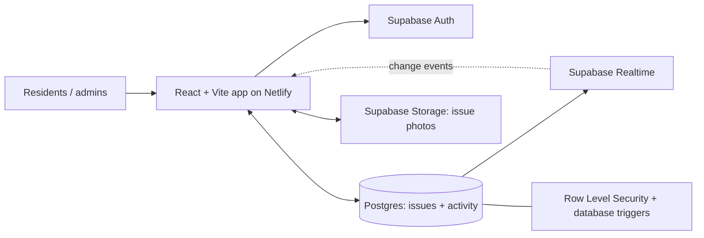

# CivicFix

**Smart Complaint & Issue Management System**  
A polished, responsive community issue tracker for reporting public-space problems, tracking resolution, and making neighborhood progress visible.

> CivicFix includes an interactive local demo that works without credentials, plus a Supabase-backed mode for shared accounts, photo storage, access controls, and real-time updates. The demo is intentionally local-only. A shared production deployment requires your own Supabase project and environment variables.

## What is included

### Resident experience
- Community overview with open, resolved, and urgent-report stats.
- Issue board with search, status/category/priority filters, and sorting.
- Create reports with title, description, a keyword-suggested category, priority, landmark, optional GPS coordinates, and optional image. A lightweight text-overlap check surfaces likely duplicate open reports before submission.
- Report detail drawer with location, attached photo, chronological activity timeline, and community updates.
- My Reports view for reports submitted by the signed-in user.
- Interactive map with issue markers and OpenStreetMap attribution.
- Analytics dashboard for status mix, issue categories, 7-day activity, resolution rate, and average resolution time when data allows.
- Responsive layouts, motion transitions, animated ambient art, hover states, keyboard shortcut (`Ctrl/Cmd + K`), toasts, and reduced-motion support.

### Administrator workflow
- Demo: switch between Resident and Admin role from the left sidebar.
- Shared mode: the `admin` role is controlled in Supabase, not by a client-side toggle.
- Move a report through Reported → Acknowledged → In progress → Resolved / Closed.
- Add assignment and resolution notes. Status changes are recorded in the activity timeline.

### Security checklist before public deployment

- Run `supabase/schema.sql` on a new Supabase project, or run `supabase/security-hardening.sql` on an existing deployment before sharing the URL.
- Create the first administrator only by registering a trusted owner account and promoting its UUID in the Supabase SQL Editor. Never add a public admin-signup flow.
- Resident signup always creates a `resident` profile. Worker applicants remain pending until an admin approves them.
- The admin portal is only a sign-in route; choosing it does not grant admin privileges. The app checks the database role after login, and database RLS remains the real security boundary.
- Do not deploy with missing Supabase environment variables: production now blocks the local demo mode instead of showing a fake admin.
- Never commit `.env.local`, Supabase service-role/secret keys, database passwords, or Twilio secrets. Keep provider secrets in Supabase Edge Function secrets.
- Test with separate resident, pending-worker, approved-worker, and admin accounts. Verify that a resident cannot update their own role, approve a worker, dispatch a task, or finalize a job.

## Stack
- React 18 + Vite
- Framer Motion
- Lucide React icons
- React Leaflet + OpenStreetMap
- Recharts
- Supabase Auth, Postgres, Storage, Row Level Security, and Realtime (optional until configured)
- Netlify deployment configuration included

## Architecture



The frontend talks directly to Supabase using a **public** key. Postgres row policies and triggers enforce shared-data access; the key itself is not a secret. Local demo mode uses browser-local data only and is available only during development. Production builds disable the demo role switch and show a configuration block if Supabase variables are missing.

## 1. Run locally

Install Node.js 20.19+ or 22.12+ (Node 22 LTS recommended) and npm.

```bash
npm install
npm run dev
```

Open the local URL printed by Vite, typically `http://localhost:5173`. **Do not double-click `index.html` to open it as a file.** React/Vite projects must be served by the development server.

On Windows, you can also double-click `START_CIVICFIX.bat` in the project folder. It checks Node.js, installs dependencies when necessary, and starts the Vite server in a terminal window. Keep that window open while using CivicFix.

If the page still appears blank, the startup page now displays a diagnostic message if the JavaScript entry point or the app module fails to load. Also open Chrome DevTools (`F12` → **Console**) and check for the first red error. Common fixes:
- `npm` or `node` is not recognized: install Node.js 22 LTS, then reopen VS Code.
- `Failed to resolve import` or `Cannot find package`: run `npm install` from the project root and wait for it to finish successfully.
- Blank page after changing `.env.local`: check that the Supabase URL and public key are pasted without quotes and restart the Vite server.

With no `.env` values during local development, CivicFix starts in **Interactive demo** mode. Try creating a report, attaching a photo, adding a timeline comment, opening Live Map and Insights, and switching the sidebar's Demo role to Admin to change issue status. Demo edits persist in `localStorage` in that browser only. Production builds do not expose this role switch or fake admin session.

## 2. Enable shared, real-time use

The hosted app needs a shared backend. This project uses Supabase so the Netlify URL does not need a custom Python server.

### A. Create the Supabase backend

1. Create a project at [supabase.com](https://supabase.com/).
2. Open **SQL Editor** in your project.
3. Paste the entire `supabase/schema.sql` file and run it.
4. Open **Project Settings → API** (or the project's Connect/API settings) and copy the Project URL and public anon/publishable key.
5. In **Authentication → URL Configuration**, add your local URL and deployed Netlify URL to the allowed redirect URLs. For local development, add `http://localhost:5173/**`.
6. Configure the email sign-in provider. If email confirmation is enabled, users must confirm their email before signing in.

The SQL creates `profiles`, `issues`, and `issue_events`; profile creation trigger; status/audit triggers; RLS policies; a public `issue-photos` Storage bucket with upload restrictions; and Realtime publication entries for report and activity changes.

### B. Add environment variables

Copy `.env.example` to `.env.local` and fill in:

```env
VITE_SUPABASE_URL=https://YOUR_PROJECT.supabase.co
VITE_SUPABASE_ANON_KEY=YOUR_PUBLIC_ANON_OR_PUBLISHABLE_KEY
```

Restart `npm run dev` after changing environment values. When both values are present, the app shows account sign-in/create-account. A person without an account can still choose **Explore interactive demo**, but those demo changes remain local and do not mix with shared data.

**Never use a Supabase `service_role` key in a Vite environment variable.** Variables prefixed with `VITE_` are embedded in browser code. The public anon/publishable key is intended for the frontend when Row Level Security is correctly configured.

### C. Harden roles and promote the first administrator

**Before public launch, run `supabase/security-hardening.sql` in Supabase SQL Editor.** This migration removes any old permissive policies on `profiles`, recreates owner/admin read access, restricts profile updates to existing admins, and prevents users from inserting/deleting profiles through the client. It is safe to re-run.

1. Register through CivicFix and confirm the account if email confirmation is enabled.
2. Open **Authentication → Users** and copy the user's UUID.
3. In SQL Editor, run the following with that UUID:

```sql
update public.profiles
set role = 'admin'
where id = 'PUT-USER-UUID-HERE';
```

Reload the app or sign out and back in. Only database-authorized admins can change issue workflow status in shared mode. Do not add a client-side admin secret or allow visitors to self-assign the role.

## 3. Deploy to Netlify

1. Push the project to a GitHub repository.
2. In Netlify, choose **Add new site → Import an existing project** and connect the repository.
3. Use these build settings (also included in `netlify.toml`):
   - Build command: `npm run build`
   - Publish directory: `dist`
4. Add `VITE_SUPABASE_URL` and `VITE_SUPABASE_ANON_KEY` under the site's environment variables.
5. Deploy. After changing build-time environment variables, trigger a new deploy.
6. Add the final Netlify URL to Supabase Authentication URL Configuration and test sign-up/sign-in from that public URL.

The `netlify.toml` includes an SPA fallback redirect, so client-side screens load directly after refresh. Official guidance: [Vite static deploy](https://vite.dev/guide/static-deploy.html), [Netlify environment variables](https://docs.netlify.com/build/environment-variables/get-started/), and [Supabase React Auth](https://supabase.com/docs/guides/auth/quickstarts/react).

## 4. Data, privacy, and production notes

- Public issue reports and their public activity timeline are visible to app visitors. Avoid putting private details or a person's home address in reports.
- Issue photos are stored in a public bucket so the report's image URL can display on the public issue board. Do not upload identifiable faces, license plates, medical information, or other sensitive content without consent.
- GPS is optional. If permission is granted, the browser coordinates are stored. The location text should describe a public landmark/street rather than a private address.
- Residents can create reports and add timeline updates. A report owner can edit permitted fields only while it remains in `reported` status; the current UI focuses on reporting and tracking rather than exposing an edit form. Workflow fields are restricted to admins by a database trigger.
- The map uses OpenStreetMap tiles and attribution. For a high-volume public service, review the applicable tile usage policy and consider a managed tile provider.
- Before a real civic launch, add moderation and abuse reporting, rate limiting, email notifications, retention policy, accessibility testing, backups, and an administrator onboarding process. This starter does not connect to any municipal authority or promise that a public agency receives submissions.
- Browser demo data is stored in localStorage and is not synchronized to another browser or device. Shared live use is enabled only after Supabase is configured.

## Project layout

```text
civicfix/
├── public/
│   ├── civicfix-mark.svg
│   └── manifest.webmanifest
├── src/
│   ├── components/
│   │   └── OperationsCenter.jsx # Resident, worker, dispatch, GPS and review workflows
│   ├── lib/
│   │   ├── backend.js       # Optional Supabase client
│   │   └── demoData.js      # Demo seed data + local persistence
│   ├── App.jsx              # Screens, forms, workflows, and data access
│   ├── main.jsx
│   └── styles.css           # Responsive visual system and animations
├── supabase/
│   ├── functions/notify-worker/index.ts # Optional Twilio SMS and voice alerts
│   └── schema.sql           # Tables, triggers, RLS, Storage, Realtime
├── .env.example
├── netlify.toml
├── package.json
└── README.md
```

## Useful commands

```bash
npm run dev      # Local development
npm run build    # Production build to dist/
npm run preview  # Preview the production build
```

## Troubleshooting

- **Still seeing demo mode:** Check that both environment values are present and restart/redeploy. Values must be available at build time.
- **Sign-up works but sign-in does not:** Check email confirmation and allowed redirect URLs in Supabase Auth settings.
- **Reports do not load:** Check that `supabase/schema.sql` ran successfully, the browser has the correct project URL/key, and the database policies exist.
- **Admin tools are missing:** Confirm the signed-in user's `profiles.role` is `admin`; a UI toggle cannot grant real privileges.
- **Photo upload fails:** Check that the `issue-photos` bucket and Storage policies exist, and that the file is JPG/PNG/WEBP under 5 MB.
- **Map is blank:** Check the browser network connection. Map tiles require internet access and the map attribution must remain visible.

## License

MIT. See `LICENSE`.

## 5. Worker applications, dispatch, GPS, evidence review, and monthly PDF

The field operations extension adds separate resident, worker, and administrator flows.

### Resident
- Apply to join the field network with a private mobile number, expertise, years of experience, an experience summary, and supporting documents.
- Follow an issue's assigned worker name, assignment progress, and company-routed contact number when dispatch has been configured.
- View worker completion photos/videos in the original report when the field worker submits evidence.
- Residents never receive a worker's personal mobile number or exact live GPS coordinates.

### Field worker
- A worker application remains `pending` until an administrator approves it. Approval changes the Supabase profile role to `worker`.
- Accept or decline offered tasks, start the route, check in at the site, and submit a completion note plus at least one image and one video.
- Starting a route explicitly enables browser geolocation. The browser must be open, location permission must be allowed, and production tracking requires HTTPS. CivicFix writes the latest fix plus sampled route history. Location tracking stops after the worker submits completion or the assignment is cancelled/finalized.
- Browser geolocation is not a guaranteed background-tracking service. Mobile browsers may throttle tracking when the tab is backgrounded or the device sleeps. For safety-critical/background tracking, use a managed native mobile app and an approved device/location policy.

### Administrator
- Review the private worker mobile number and proof documents, approve or reject applicants, set the public company contact line, assign open issues, see current GPS fixes and timestamps, inspect completion evidence, and finalize work.
- An issue with a dispatched worker cannot be marked resolved through the older issue-status controls until the assignment has been finalized. The database requires a completion photo and video plus an administrator note.
- Download a month-based PDF. It includes any issue reported in the selected month or resolved in that month, with status, priority, category, assigned worker, dates, location, and resolution notes.

### Supabase migration
Use the **complete updated** `supabase/schema.sql` in SQL Editor. If the base CivicFix schema was already run, rerunning the full updated file adds the field-operations tables, policies, private buckets, and Realtime publications. The new tables include:
- `worker_profiles` for worker applications and private experience data.
- `issue_assignments` for dispatch and the task state machine.
- `worker_notifications` for in-app task alerts.
- `worker_locations` and `worker_location_history` for current location and sampled route history.
- `issue_evidence` for private worker completion photos and videos.
- `app_settings` for the company-routed public contact number.

Keep `SUPABASE_SERVICE_ROLE_KEY`, database passwords, and telephony credentials out of the React `.env.local` and Netlify `VITE_*` variables. Browser access is governed by RLS. The worker verification and completion evidence buckets are private; users receive time-limited signed links when they are authorized to view a file.

### Voice and SMS notifications (optional provider integration)
In-app notifications are created by the database as soon as an administrator dispatches a task. Voice/SMS requires the included Edge Function and Twilio credentials; without them, the task still appears in the worker inbox but an external call is not placed.

1. Install the Supabase CLI and authenticate: `supabase login`.
2. Link the local project to your Supabase project: `supabase link --project-ref YOUR_PROJECT_REF`.
3. Deploy the function from the project root: `supabase functions deploy notify-worker`.
4. Set server-side secrets (never add these to `.env.local`):

```bash
supabase secrets set TWILIO_ACCOUNT_SID=ACxxxxxxxxxxxxxxxxxxxxxxxxxxxxxxxx TWILIO_AUTH_TOKEN=your_twilio_auth_token TWILIO_FROM_NUMBER=+1xxxxxxxxxx
```

5. In Twilio, configure an approved sender number and verify recipients if using a trial account. The function sends an assignment SMS and an automated voice call to the worker's private mobile, which only the server-side function reads. Provider failures do not delete the in-app notification.
6. In Field operations, set the public company contact line to a **company-controlled number**. Configure your telephony provider's inbound routing (for example, Twilio Studio/Programmable Voice or an approved proxy service) so calls to this public number reach the appropriate dispatcher/assigned worker. CivicFix deliberately does not expose the worker's personal number as the public contact.

Voice calls, SMS, proxy forwarding, and carrier delivery depend on provider setup, account permissions, regional rules, and billing. Test with authorized staff numbers before using with the public. The included function handles outbound assignment alerts; inbound call routing must be configured with the telephony provider.

### Operational and privacy notes
- GPS recording is enabled only after a worker accepts the task and explicitly starts the route. Exact location tables are restricted by RLS to administrators and the assigned worker.
- Worker phone numbers and verification documents are admin-only. A company phone is the only contact number placed on a public issue.
- Upload only evidence you are authorized to collect. Do not upload private faces, plates, or sensitive details unrelated to the issue. Have a retention policy for proof documents and route history.
- The demo role switch is for local walkthroughs only. Demo records and GPS points are browser-local/simulated and are not shared. Use Supabase-backed accounts to test cross-device realtime behavior.


**Phone delivery format:** For outbound Twilio SMS/voice, enter a worker mobile number in international E.164 format (for example `+919876543210`). CivicFix does not infer country codes from local numbers. In-app alerts work independently of telephony configuration.


## Role-specific access update

The sign-in screen now has separate Resident, Field Worker, and Administrator portal choices. The selected portal is checked against the authenticated user's `profiles.role`; selecting a portal does not grant that role. Admin accounts must be promoted securely by the project owner in Supabase. Worker applicants should create an account, sign in through Resident access, and submit their application from **Join as worker**. An administrator must approve the application before the account receives worker permissions.

New account passwords must contain at least 8 characters, including uppercase and lowercase letters, a number, and a symbol. The form shows a live checklist. Existing worker dispatch, task progress, GPS check-ins, completion photo/video evidence, admin review, and PDF reporting still depend on applying the Supabase schema and configuring the project's required services.
